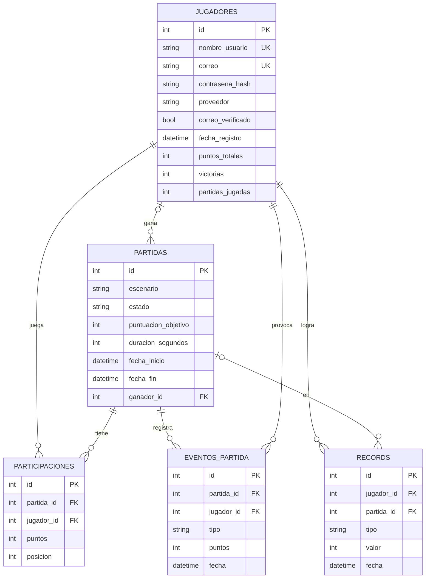

# Modelo de datos

**Motor:** PostgreSQL 16, en un contenedor de Docker para desarrollo (`docker-compose.yml`).
**Acceso desde el backend:** SQLAlchemy (ORM). Las tablas se definen en `backend/app/models.py`
y se crean automáticamente al arrancar el backend.

Basado en el diagrama de despliegue del ERS, que pide guardar: usuarios, credenciales,
partidas, puntajes, eventos, ranking y estadísticas.

## Diagrama entidad-relación

## Tablas

| Tabla | Qué guarda | Lo pide |
|---|---|---|
| `jugadores` | Usuario, correo, contraseña cifrada, proveedor de login y estadísticas acumuladas | Usuarios, credenciales, estadísticas · RN-01, RN-02, RNF-04 |
| `partidas` | Escenario, estado (`en_espera`, `en_curso`, `finalizada`), tiempos y ganador | Partidas · US-007, US-019 |
| `participaciones` | Puntos y posición final de cada jugador en cada partida | Puntajes · US-020 |
| `eventos_partida` | Lo que ocurre en una partida: extracciones, terminales, penalizaciones | Eventos · US-009, US-010, US-014 |
| `records` | Récords históricos por jugador | Récords · US-023 |

## Decisiones

- **El ranking no tiene tabla propia.** Se calcula sumando `participaciones.puntos` por jugador
  (o usando `jugadores.puntos_totales`), así nunca queda desactualizado.
- **Correo y usuario únicos** con restricciones `UNIQUE` en la base de datos, no solo validación en código.
- **`contrasena_hash` puede estar vacía** para cuentas creadas con Google, GitHub, etc. (US-002).
- **Una sola base de datos en el Sprint 2.** La arquitectura lógica del ERS propone bases regionales
  (América y Europa) con balance de carga; eso queda como arquitectura ideal y no se implementa por ahora.
- **Pruebas con SQLite en memoria**, para que corran sin Docker en cualquier compu y en el pipeline de CI.